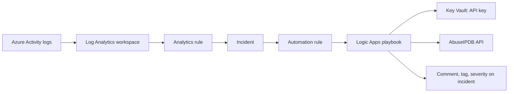
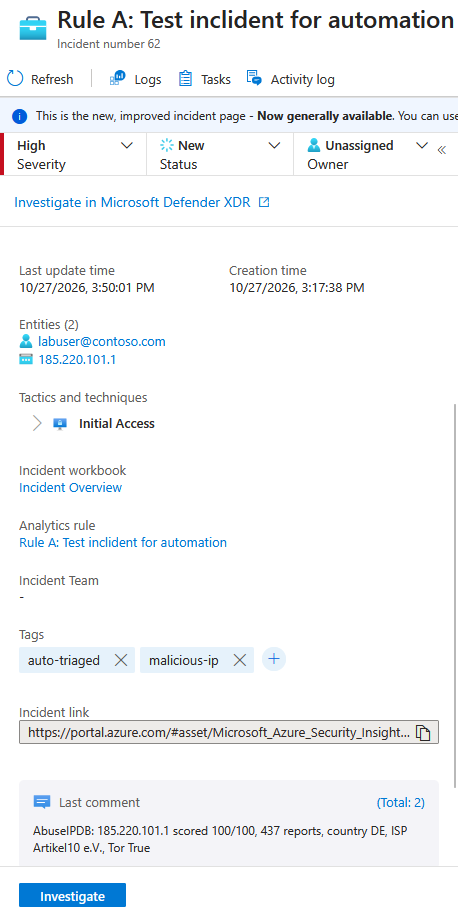
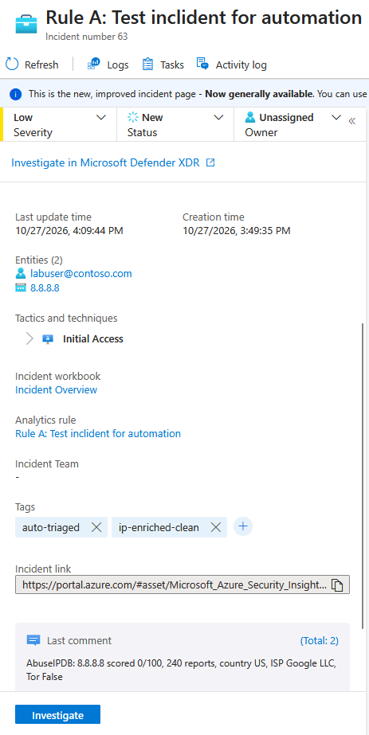
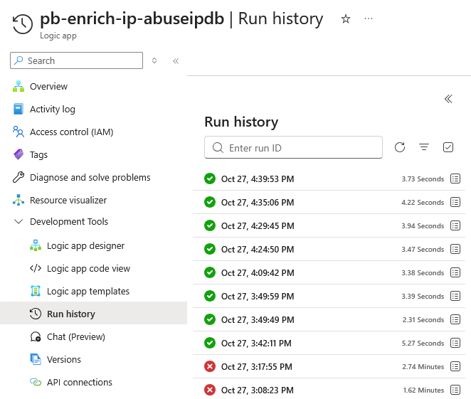

# Microsoft Sentinel SOAR: IP Enrichment Playbook

An end to end security automation lab in Microsoft Sentinel. A detection raises an incident, an automation rule triggers a Logic Apps playbook, and the playbook enriches every IP entity on the incident with AbuseIPDB threat intelligence, comments the results, tags the incident, and raises severity when an IP is malicious.

Tested on both synthetic incidents and a real detection from Azure Activity telemetry.

## Architecture



## Components

| Component | Name | Purpose |
| --- | --- | --- |
| Log Analytics workspace | law-sentinel-la | Stores logs queried by Sentinel |
| Microsoft Sentinel | on law-sentinel-la | Analytics rules, incidents, automation rules |
| Data connector | Azure Activity | Real telemetry for the role assignment detection |
| Analytics rule A | Rule A: Test incident for automation | Synthetic incident on demand for testing |
| Analytics rule B | Rule B: Role assignment created | Real Privilege Escalation detection |
| Automation rule | ar-enrich-all-incidents | Tags incidents and runs the playbook on creation |
| Playbook | pb-enrich-ip-abuseipdb | Logic Apps (Consumption) enrichment workflow |
| Key Vault | kv-sentinel-lab-* | Stores the AbuseIPDB API key |

## Playbook logic

1. Trigger: Microsoft Sentinel incident
2. Entities - Get IPs from the incident
3. Get the AbuseIPDB API key from Key Vault (secure outputs on)
4. For each IP:
   - HTTP GET to the AbuseIPDB check endpoint (secure inputs on)
   - Parse JSON on the response
   - Add a comment to the incident with score, report count, country, ISP and Tor flag
   - Condition: `abuseConfidenceScore >= 50`
     - True: set severity to High, add tag `malicious-ip`
     - False: add tag `ip-enriched-clean`

## Security design

**Least privilege**

| Identity | Role | Scope | Why |
| --- | --- | --- | --- |
| Playbook managed identity | Microsoft Sentinel Responder | Workspace | Comment on and update incidents, nothing more |
| Playbook managed identity | Key Vault Secrets User | Key Vault | Read the API key only |
| Sentinel service account | Microsoft Sentinel Automation Contributor | Playbook resource group only | Trigger playbooks |

**Secrets handling**

- No credentials in the workflow. The playbook authenticates with a system-assigned managed identity.
- The API key lives in Key Vault and is read at runtime.
- Secure inputs and outputs hide the key from run history.

**Human in the loop**

This playbook only enriches and flags. Destructive actions such as disabling an account or isolating a host belong behind an analyst approval step.

## Detections

**Rule A: synthetic test incident**

```kql
print TimeGenerated = now(),
      Account = "labuser@contoso.com",
      IPAddress = "185.220.101.1",
      Activity = "Lab test: sign-in from suspicious IP"
```

Entity mapping: Account > FullName = Account, IP > Address = IPAddress.

**Rule B: role assignment created**

```kql
AzureActivity
| where ingestion_time() > ago(15m)
| where OperationNameValue =~ "MICROSOFT.AUTHORIZATION/ROLEASSIGNMENTS/WRITE"
| where ActivityStatusValue =~ "Success"
| project TimeGenerated, Caller, CallerIpAddress, ResourceGroup, _ResourceId
```

Runs every 15 minutes with a 1 hour lookback. The longer lookback tolerates Azure Activity ingestion delay, and the `ingestion_time()` filter makes each event match only one run, so a single role assignment raises a single incident.

Entity mapping: Account > FullName = Caller, IP > Address = CallerIpAddress, Azure resource > ResourceId = _ResourceId. Tactic: Privilege Escalation (T1098, Account Manipulation).

## Test results

| Test | Input | Result |
| --- | --- | --- |
| True branch | 185.220.101.1 (Tor exit node) | Score 100/100, tagged `malicious-ip`, severity raised Low to High |
| False branch | 8.8.8.8 | Score 0/100, tagged `ip-enriched-clean`, severity unchanged |
| Real detection | Role assignment in the subscription | Medium incident from Rule B, caller IP enriched, tagged `ip-enriched-clean` |





## Troubleshooting notes from the build

Real issues hit while building this, and how they were found:

| Symptom | Root cause | Lesson |
| --- | --- | --- |
| Get secret failed with 502 BadGateway after minutes of retries | One-character typo in the vault name on the Key Vault connection, so DNS could not resolve the vault | A misleading status code; the inner error message held the real cause |
| False branch never ran its action | The action was lost when a publish failed on an expired portal session | Confirm the publish succeeded, and test every branch |
| Rule B could raise repeat incidents for one event | 15 minute schedule with a 1 hour lookback re-matched the same rows | Added an `ingestion_time()` filter so each event is evaluated once |
| Secret creation failed as subscription Owner | Key Vault RBAC model needs an explicit data plane role | Owner on the subscription is not Key Vault Secrets Officer |

## Repository layout

```
playbooks/
  pb-enrich-ip-abuseipdb/azuredeploy.json
analytics-rules/
  rule-a-test-incident.json
  rule-b-role-assignment.json
docs/images/
README.md
```

## Deploying

[](https://portal.azure.com/#create/Microsoft.Template/uri/https%3A%2F%2Fraw.githubusercontent.com%2FRichkpa%2Fsentinel-soar-enrichment%2Fmain%2Fplaybooks%2Fpb-enrich-ip-abuseipdb%2Fazuredeploy.json) 

1. Create a Log Analytics workspace and enable Microsoft Sentinel on it.
2. Install the Azure Activity solution from Content hub and connect it.
3. Import the analytics rules from `analytics-rules/` (Analytics > Import).
4. Create a Key Vault (RBAC model) and a secret `abuseipdb-api-key`.
5. Deploy `playbooks/pb-enrich-ip-abuseipdb/azuredeploy.json` into the resource group, passing `KeyVaultName`. The template creates both API connections with managed identity auth and outputs the playbook's principal ID for the role assignments.
6. Assign the playbook identity Microsoft Sentinel Responder on the workspace and Key Vault Secrets User on the vault.
7. Sentinel > Settings > Playbook permissions: grant access to the playbook's resource group.
8. Create an automation rule: on incident created, run the playbook.

## Next up

- [ ] Failure handling: scope plus run-after branch that comments when enrichment fails
- [ ] Skip private IP ranges before calling the API
- [ ] Single severity update after the loop based on the highest score
- [ ] Identity context from Microsoft Graph (group memberships, recent sign-ins)
- [ ] Approval-gated remediation through a Teams adaptive card
- [ ] Ticket creation in Jira
- [ ] Detection for unsanctioned AI tool activity, enriched the same way
